<p>
<picture>
  <source media="(prefers-color-scheme: light)" srcset="assets/banner/hero-v2-light.svg">
  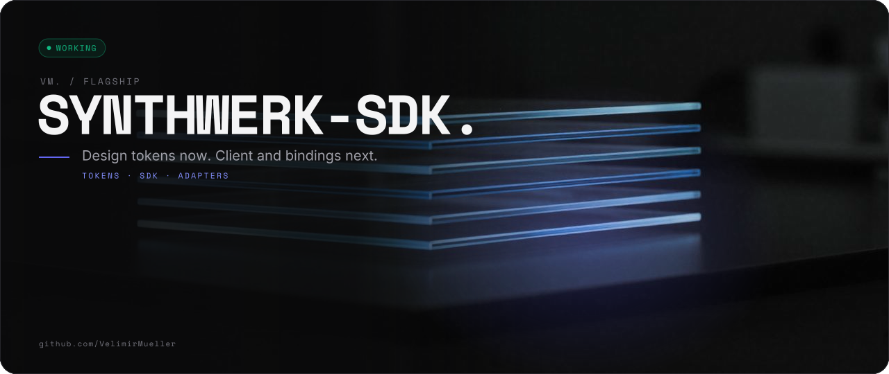
</picture>
</p>

<p>
<picture>
  <source media="(prefers-color-scheme: light)" srcset="assets/readme/lead-v2-light.svg">
  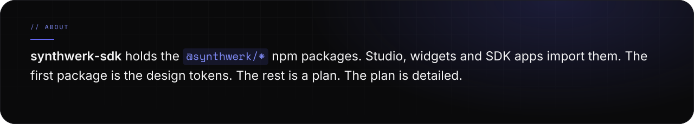
</picture>
</p>

<p>
<picture>
  <source media="(prefers-color-scheme: light)" srcset="assets/readme/stats-v2-light.svg">
  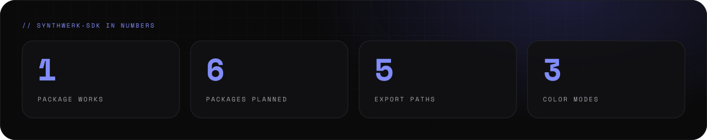
</picture>
</p>

<br>

<p>
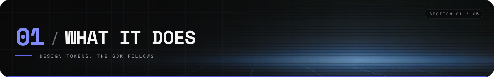
</p>

<p>
<picture>
  <source media="(prefers-color-scheme: light)" srcset="assets/readme/features-v2-light.svg">
  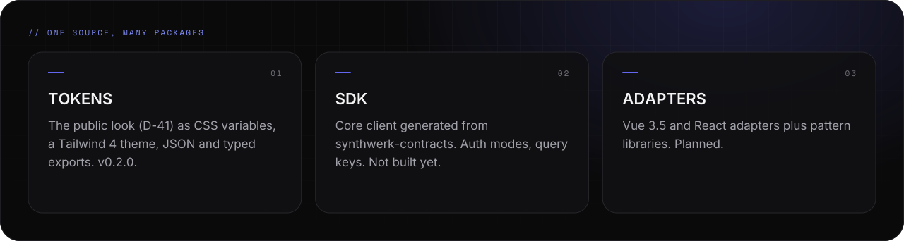
</picture>
</p>

<p>
<picture>
  <source media="(prefers-color-scheme: light)" srcset="assets/readme/what-v2-light.svg">
  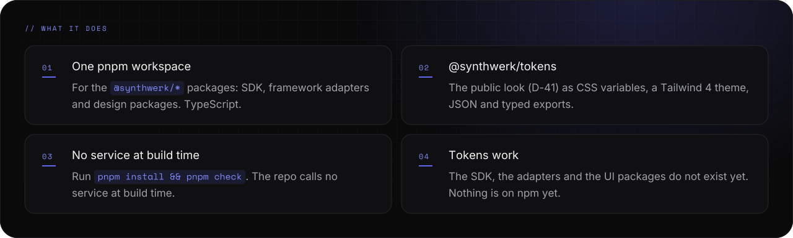
</picture>
</p>

<br>

<p>
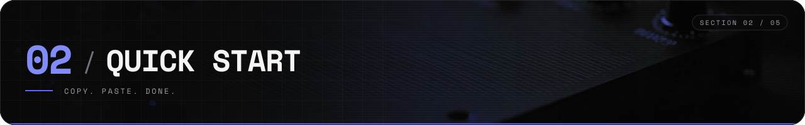
</p>

<p>
<picture>
  <source media="(prefers-color-scheme: light)" srcset="assets/readme/start-v2-light.svg">
  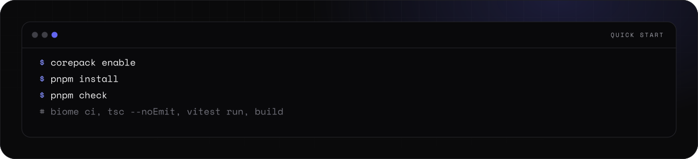
</picture>
</p>

<p>
<picture>
  <source media="(prefers-color-scheme: light)" srcset="assets/readme/demo-v2-light.svg">
  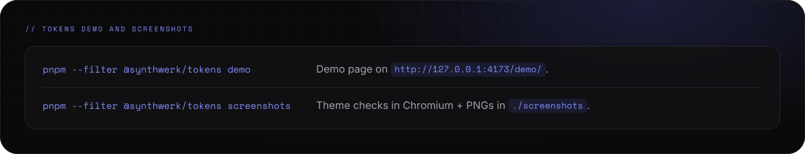
</picture>
</p>

<p>
<picture>
  <source media="(prefers-color-scheme: light)" srcset="assets/readme/import-v2-light.svg">
  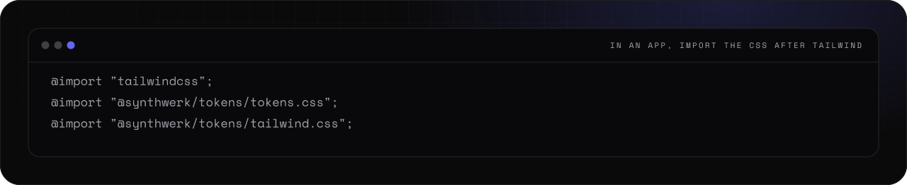
</picture>
</p>

<details>
<summary><picture><source media="(prefers-color-scheme: light)" srcset="assets/readme/links-9-v2-light.svg"></picture></summary>

```bash
corepack enable
pnpm install
pnpm check      # biome ci, tsc --noEmit, vitest run, build
pnpm --filter @synthwerk/tokens demo         # demo page on http://127.0.0.1:4173/demo/
pnpm --filter @synthwerk/tokens screenshots  # theme checks in Chromium + PNGs in ./screenshots
```

```css
@import "tailwindcss";
@import "@synthwerk/tokens/tokens.css";
@import "@synthwerk/tokens/tailwind.css";
```

</details>

<br>

<p>
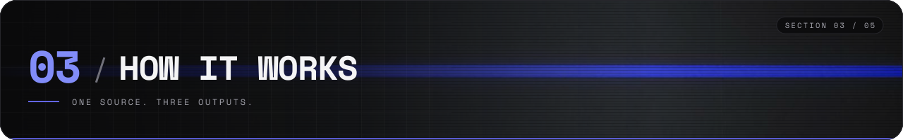
</p>

<p>
<picture>
  <source media="(prefers-color-scheme: light)" srcset="assets/readme/flow-v2-light.svg">
  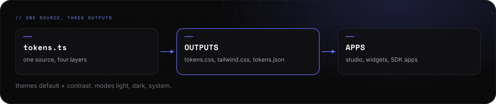
</picture>
</p>

<p>
<picture>
  <source media="(prefers-color-scheme: light)" srcset="assets/readme/outputs-v2-light.svg">
  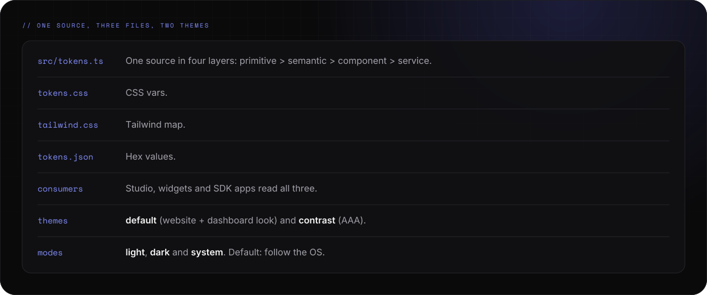
</picture>
</p>

<p align="center">
<a href="https://github.com/VelimirMueller/synthwerk"><picture><source media="(prefers-color-scheme: light)" srcset="assets/readme/links-1-v2-light.svg">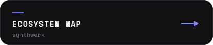</picture></a>
<a href="docs/REFERENCE.md"><picture><source media="(prefers-color-scheme: light)" srcset="assets/readme/links-2-v2-light.svg"></picture></a>
</p>

<br>

<p>
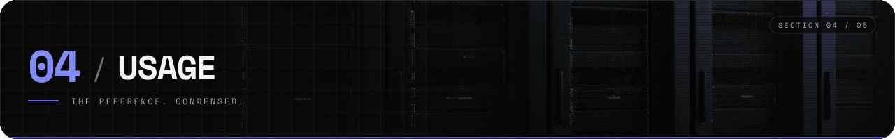
</p>

<p>
<picture>
  <source media="(prefers-color-scheme: light)" srcset="assets/readme/packages-v2-light.svg">
  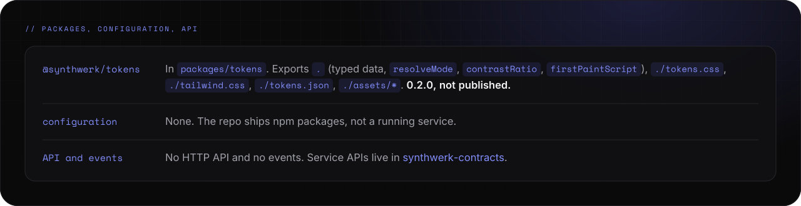
</picture>
</p>

<p>
<picture>
  <source media="(prefers-color-scheme: light)" srcset="assets/readme/dev-v2-light.svg">
  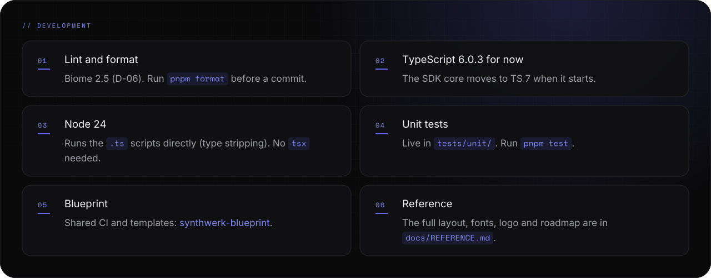
</picture>
</p>

<p align="center">
<a href="packages/tokens"><picture><source media="(prefers-color-scheme: light)" srcset="assets/readme/links-3-v2-light.svg">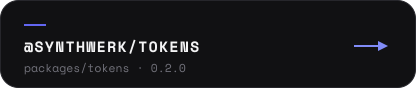</picture></a>
<a href="https://github.com/VelimirMueller/synthwerk-contracts"><picture><source media="(prefers-color-scheme: light)" srcset="assets/readme/links-4-v2-light.svg">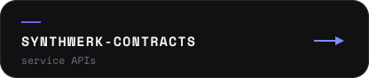</picture></a>
<a href="https://github.com/VelimirMueller/synthwerk-blueprint"><picture><source media="(prefers-color-scheme: light)" srcset="assets/readme/links-5-v2-light.svg"></picture></a>
</p>

<br>

<p>
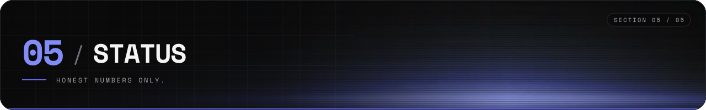
</p>

<p>
<picture>
  <source media="(prefers-color-scheme: light)" srcset="assets/readme/status-v2-light.svg">
  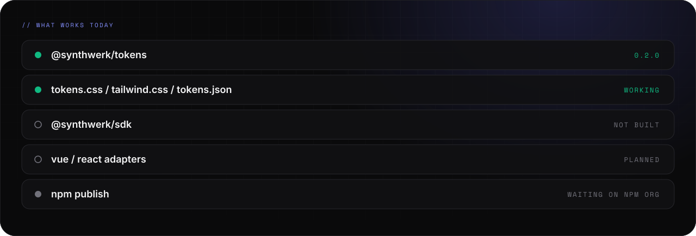
</picture>
</p>

<p>
<picture>
  <source media="(prefers-color-scheme: light)" srcset="assets/readme/now-v2-light.svg">
  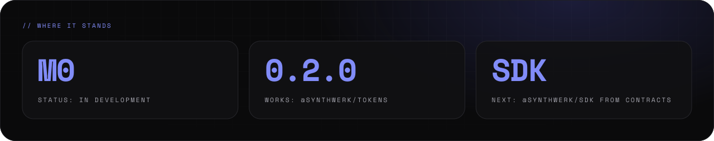
</picture>
</p>

<p>
<picture>
  <source media="(prefers-color-scheme: light)" srcset="assets/readme/check-v2-light.svg">
  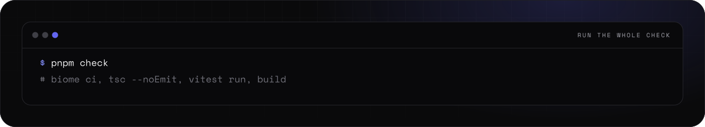
</picture>
</p>

<p>
<picture>
  <source media="(prefers-color-scheme: light)" srcset="assets/readme/docs-v2-light.svg">
  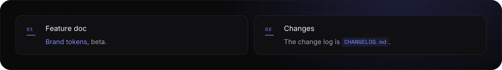
</picture>
</p>

<p align="center">
<a href="docs/features/brand-tokens.md"><picture><source media="(prefers-color-scheme: light)" srcset="assets/readme/links-6-v2-light.svg">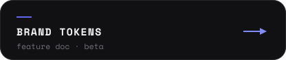</picture></a>
<a href="CHANGELOG.md"><picture><source media="(prefers-color-scheme: light)" srcset="assets/readme/links-7-v2-light.svg">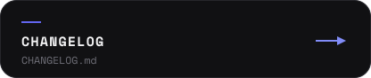</picture></a>
<a href="LICENSE"><picture><source media="(prefers-color-scheme: light)" srcset="assets/readme/links-8-v2-light.svg"></picture></a>
</p>

<p>
<picture>
  <source media="(prefers-color-scheme: light)" srcset="assets/readme/footer-v2-light.svg">
  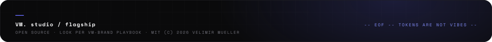
</picture>
</p>
